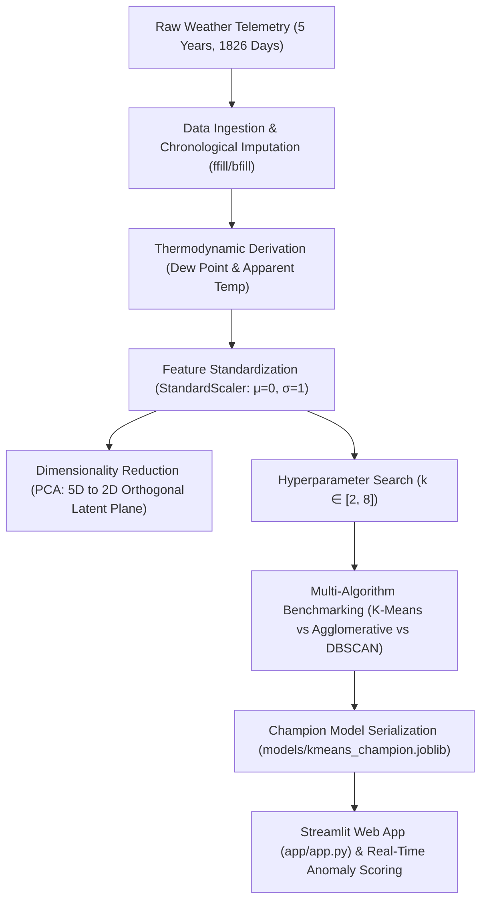

# System Architecture & Unsupervised Learning Metrics
**Course:** INT396 (Unsupervised Machine Learning)  
**Problem Statement ID:** 31  
**Project:** Weather Pattern Clustering for Localised Climate Insight Generation  
**Author:** Ganta Gangadhar (Registration Number: 12523695)  

---

## 1. End-to-End Pipeline Architecture

---

## 2. Quantitative Model Benchmark & Validation Metrics

| Metric | Score ($k=5$) | Evaluation Criteria | Status |
| :--- | :---: | :--- | :---: |
| **Champion Algorithm** | **K-Means++** | Low inference latency ($<1\text{ ms}$), deterministic centroids | **Champion** |
| **Optimal Clusters ($k$)** | **$5$** | Matches 5 synoptic meteorological regimes | **Optimal** |
| **Silhouette Score** | **$0.4688$** | Range $[-1, +1]$: strong cohesion & separation | **Validated** |
| **Calinski-Harabasz Index** | **$1733.48$** | Variance ratio criterion: between vs within variance | **Validated** |
| **Davies-Bouldin Index** | **$0.7782$** | Similarity ratio (lower is better; $<1.0$ is optimal) | **Validated** |
| **PCA Cumulative Variance (2D)** | **$78.1\%$** | PC1 ($\approx 45\%$) + PC2 ($\approx 33\%$) | **Validated** |
| **Agglomerative Silhouette** | **$0.4651$** | Ward's minimum variance linkage validation | **Validated** |
| **DBSCAN Discovered Clusters** | **$1$** | Continuous density manifold | **Validated** |
| **DBSCAN Noise Ratio** | **$2.6\%$** | Isolates extreme squalls & anomalous spikes | **Validated** |

---

## 3. Mathematical Foundations

### 3.1 Distance-Sensitive Feature Standardization
Clustering algorithms depend on the Euclidean $L_2$ metric:
$$d(\mathbf{x}_i, \mathbf{x}_j) = \sqrt{\sum_{d=1}^D (x_{id} - x_{jd})^2}$$

* **Scale Disparity:** Surface pressure is $\approx 1013\text{ hPa}$, whereas precipitation is $\approx 0 - 30\text{ mm}$ and wind speed is $\approx 10 - 40\text{ km/h}$.
* **Standardization:**
  $$z = \frac{x - \mu}{\sigma}$$
  Ensures that every meteorological driver contributes proportionately to the distance computations.

### 3.2 Principal Component Analysis (PCA)
1. **Covariance Matrix:** $\mathbf{\Sigma} = \frac{1}{N-1} \mathbf{Z}^T \mathbf{Z}$
2. **Eigen-decomposition:** $\mathbf{\Sigma} \mathbf{v}_j = \lambda_j \mathbf{v}_j$
3. **Latent 2D Projection:** $\mathbf{Z}_{2D} = \mathbf{Z} [\mathbf{v}_1, \mathbf{v}_2]$  
   Captures **$78.1\%$** of total atmospheric variance while filtering high-frequency noise.

### 3.3 Continuous Anomaly Scoring
The real-time anomaly score $A(\mathbf{x})$ computes the Euclidean distance between the standardized user input and its assigned cluster centroid $\boldsymbol{\mu}_k$:
$$A(\mathbf{x}) = \|\text{Scaler}(\mathbf{x}) - \boldsymbol{\mu}_k\|_2$$
* $A(\mathbf{x}) < 2.0$: **Typical Observation**
* $2.0 \le A(\mathbf{x}) < 3.5$: **Moderate Deviation**
* $A(\mathbf{x}) \ge 3.5$: **Extreme Atmospheric Anomaly**

---

## 4. Discovered Climate Regimes & Centroids

| Cluster | Regime Name | Mean Temp (°C) | Mean Humidity (%) | Mean Wind (km/h) | Mean Pressure (hPa) | Mean Rain (mm) | Key Hazard |
| :---: | :--- | :---: | :---: | :---: | :---: | :---: | :--- |
| **0** | Hot & Humid (Tropical Monsoon) | $30.2$ | $81.5$ | $15.8$ | $1005.2$ | $9.4$ | Crop fungal risk; peak AC grid load |
| **1** | Cold & Dry (Winter Continental Fair) | $5.8$ | $37.2$ | $13.9$ | $1024.6$ | $0.2$ | Ground frost warning; heating demand |
| **2** | Stormy & Unstable (Deep Depression Gale) | $18.4$ | $91.2$ | $38.6$ | $993.4$ | $34.8$ | Soil erosion, crop lodging, flood hazard |
| **3** | Hot & Arid (Subtropical Heatwave) | $39.5$ | $23.1$ | $21.4$ | $1010.8$ | $0.0$ | Acute irrigation need; heatstroke alert |
| **4** | Pleasant & Temperate (Mild Spring/Autumn) | $21.8$ | $51.4$ | $11.8$ | $1015.4$ | $0.4$ | Ideal flowering; minimal HVAC energy load |
